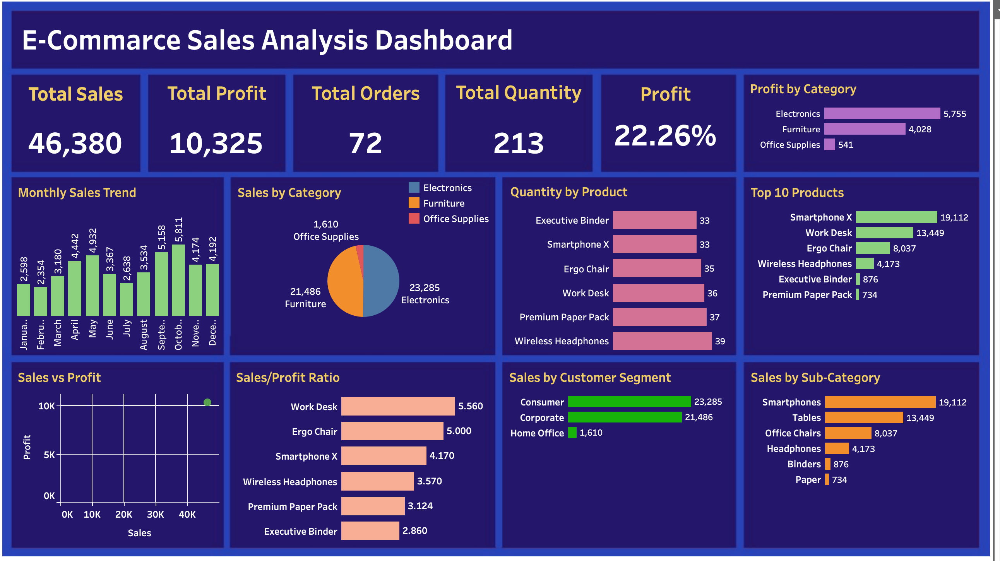

# E-Commerce Sales Analysis Dashboard

## Project Overview
This project analyzes e-commerce sales performance using an interactive dashboard built in **Tableau**. It presents key business metrics and visualizations to help understand sales, profit, orders, product performance, customer segments, and category-level trends.

## Dashboard Preview


> **Note:** Upload `Dashboard_Screenshort.png` to the same GitHub repository folder as this README so the preview appears correctly.

## Key Performance Indicators (KPIs)

| KPI | Dashboard Value |
|---|---:|
| Total Sales | 46,380 |
| Total Profit | 10,325 |
| Total Orders | 72 |
| Total Quantity | 213 |
| Profit Margin | 22.26% |

## Dashboard Visualizations
The dashboard includes the following analyses:

- **Monthly Sales Trend** — compares sales across the months of the year.
- **Sales by Category** — compares sales across Electronics, Furniture, and Office Supplies.
- **Profit by Category** — shows category-level profit.
- **Quantity by Product** — compares quantities across selected products.
- **Top Products** — highlights products with the highest sales.
- **Sales vs. Profit** — compares overall sales and profit.
- **Sales/Profit Ratio** — compares the displayed ratio across selected products.
- **Sales by Customer Segment** — compares Consumer, Corporate, and Home Office sales.
- **Sales by Sub-Category** — compares sales across product sub-categories.

## Key Insights
Based on the values displayed in the dashboard:

- Total sales are **46,380**, with total profit of **10,325**.
- The displayed profit margin is **22.26%**.
- **Electronics** has the highest displayed category profit (**5,755**), followed by **Furniture (4,028)** and **Office Supplies (541)**.
- In the category sales chart, Electronics leads with **23,285**, followed by Furniture (**21,486**) and Office Supplies (**1,610**).
- The Consumer segment has the highest displayed sales (**23,285**), followed by Corporate (**21,486**) and Home Office (**1,610**).
- Smartphone X is the leading product by displayed sales (**19,112**).

## Tools & Technologies
- **Tableau** — dashboard development and data visualization
- **CSV** — cleaned dataset used for analysis
- **Microsoft Excel / spreadsheet tools** — suitable for reviewing and preparing tabular data

## Files in This Repository
Suggested repository structure:

```text
E-Commerce-Sales-Analysis/
├── README.md
├── Dashboard_Screenshort.png
├── E-commarce_Cleaned.csv
└── E-Commarce_Sales_App_Dashbord.twbx
```

- `Dashboard_Screenshort.png` — dashboard preview image
- `E-commarce_Cleaned.csv` — cleaned dataset
- `E-Commarce_Sales_App_Dashbord.twbx` — packaged Tableau workbook

## How to View the Project
1. Clone or download this repository.
2. Open `E-Commarce_Sales_App_Dashbord.twbx` in Tableau Desktop or a compatible Tableau application.
3. If Tableau asks for the data source, follow the prompts to reconnect it to `E-commarce_Cleaned.csv`.
4. Explore the dashboard charts and filters, if available.

## Purpose
The goal of this project is to turn sales data into a clear visual summary that supports business reporting and helps identify trends across categories, products, and customer segments.

---
**Author:** Your Name  
**Project Type:** Data Analytics / Data Visualization
